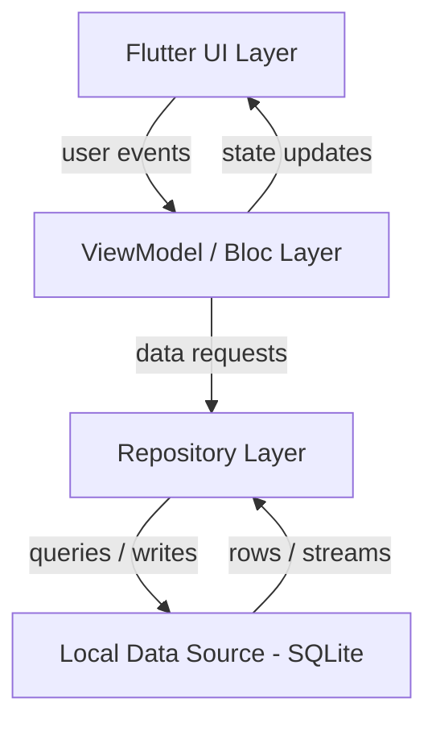
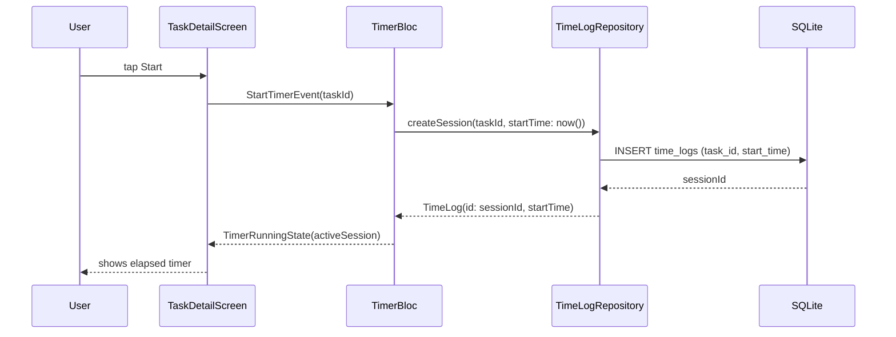
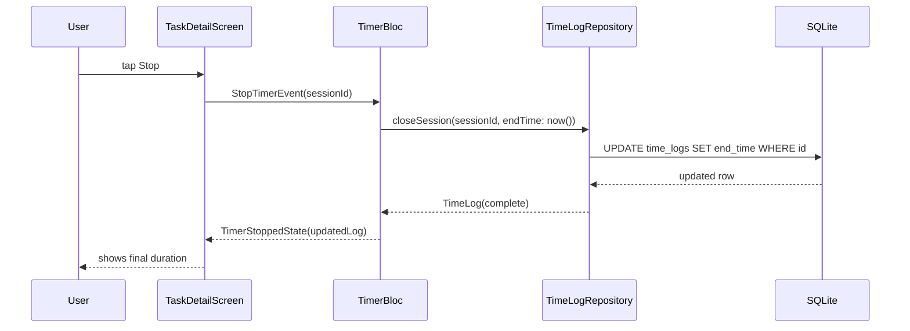
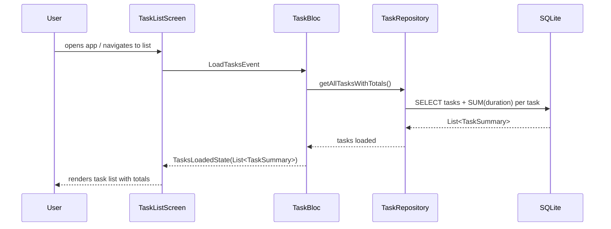

# Design Document: Time Tracker

## Overview

A cross-platform mobile time tracking app built with Flutter that lets users create task labels and log time sessions against them. Users can start and stop timers per task, view individual session history, and see total time accumulated per task.

The app runs fully on-device using local persistence (SQLite via `drift` or `sqflite`), with no backend required. State management uses a reactive pattern (e.g., Riverpod or Bloc) so the UI reflects timer state in real time.

The architecture follows a clean layered approach: UI → ViewModel/Bloc → Repository → Local Data Source. This keeps business logic testable and decoupled from Flutter widgets.

---

## Architecture



---

## Sequence Diagrams

### Start Timer



### Stop Timer



### View Task Summary



---

## Components and Interfaces

### TaskRepository

**Purpose**: CRUD operations for task labels.

**Interface**:
```dart
abstract class TaskRepository {
  Future<List<Task>> getAllTasks();
  Future<Task> createTask(String label);
  Future<void> deleteTask(String taskId);
  Stream<List<TaskSummary>> watchTasksWithTotals();
}
```

**Responsibilities**:
- Persist and retrieve task labels
- Provide a reactive stream of tasks with aggregated total durations

### TimeLogRepository

**Purpose**: Manages time session records (open and closed).

**Interface**:
```dart
abstract class TimeLogRepository {
  Future<TimeLog> createSession(String taskId, DateTime startTime);
  Future<TimeLog> closeSession(String sessionId, DateTime endTime);
  Future<List<TimeLog>> getSessionsForTask(String taskId);
  Future<TimeLog?> getActiveSession(String taskId);
}
```

**Responsibilities**:
- Insert new open sessions (no end time)
- Update sessions with end time on stop
- Query sessions per task for detail view
- Detect if a task already has an active (unclosed) session

### TimerBloc / TimerViewModel

**Purpose**: Manages timer state for a single task.

**Interface**:
```dart
// Events
sealed class TimerEvent {}
class StartTimerEvent extends TimerEvent { final String taskId; }
class StopTimerEvent extends TimerEvent { final String sessionId; }
class TickEvent extends TimerEvent {}

// States
sealed class TimerState {}
class TimerIdle extends TimerState {}
class TimerRunning extends TimerState {
  final TimeLog activeSession;
  final Duration elapsed;
}
class TimerStopped extends TimerState { final TimeLog completedSession; }
class TimerError extends TimerState { final String message; }
```

**Responsibilities**:
- Coordinate start/stop with `TimeLogRepository`
- Drive a periodic `Ticker` (1-second interval) to emit elapsed time
- Expose current state to the UI

### TaskBloc / TaskViewModel

**Purpose**: Manages task list and creation.

**Interface**:
```dart
sealed class TaskEvent {}
class LoadTasksEvent extends TaskEvent {}
class CreateTaskEvent extends TaskEvent { final String label; }
class DeleteTaskEvent extends TaskEvent { final String taskId; }

sealed class TaskState {}
class TasksLoading extends TaskState {}
class TasksLoaded extends TaskState { final List<TaskSummary> tasks; }
class TaskError extends TaskState { final String message; }
```

---

## Data Models

### Task

```dart
class Task {
  final String id;       // UUID
  final String label;    // user-defined name
  final DateTime createdAt;
}
```

**Validation Rules**:
- `label` must be non-empty and ≤ 100 characters
- `id` is generated on creation (UUID v4)

### TimeLog

```dart
class TimeLog {
  final String id;          // UUID
  final String taskId;      // FK → Task.id
  final DateTime startTime;
  final DateTime? endTime;  // null = session still active
}
```

**Derived property**:
```dart
Duration? get duration =>
    endTime != null ? endTime!.difference(startTime) : null;

bool get isActive => endTime == null;
```

**Validation Rules**:
- `endTime`, when set, must be after `startTime`
- Only one active session (null `endTime`) allowed per task at a time

### TaskSummary

```dart
class TaskSummary {
  final Task task;
  final Duration totalDuration;
  final bool hasActiveSession;
}
```

---

## Algorithmic Pseudocode

### Start Timer Algorithm

```pascal
PROCEDURE startTimer(taskId: UUID)
  INPUT: taskId — identifier of the task to time
  OUTPUT: TimeLog (active session)

  PRECONDITION: taskId refers to an existing Task
  PRECONDITION: no active session exists for taskId

  BEGIN
    existing ← timeLogRepository.getActiveSession(taskId)

    IF existing IS NOT NULL THEN
      RAISE Error("Task already has an active session")
    END IF

    session ← TimeLog {
      id        ← generateUUID(),
      taskId    ← taskId,
      startTime ← now(),
      endTime   ← null
    }

    timeLogRepository.createSession(session)
    ticker.start(interval: 1 second, onTick: emitTick)

    RETURN session
  END

  POSTCONDITION: a TimeLog row exists with endTime = null
  POSTCONDITION: ticker is running
END PROCEDURE
```

### Stop Timer Algorithm

```pascal
PROCEDURE stopTimer(sessionId: UUID)
  INPUT: sessionId — identifier of the active session
  OUTPUT: TimeLog (completed session)

  PRECONDITION: session with sessionId exists and endTime IS NULL

  BEGIN
    endTime ← now()
    session ← timeLogRepository.closeSession(sessionId, endTime)

    ticker.stop()

    ASSERT session.endTime IS NOT NULL
    ASSERT session.endTime > session.startTime

    RETURN session
  END

  POSTCONDITION: TimeLog row has endTime set
  POSTCONDITION: ticker is stopped
  LOOP INVARIANT: N/A (no loop)
END PROCEDURE
```

### Compute Total Duration Algorithm

```pascal
FUNCTION computeTotalDuration(sessions: List<TimeLog>): Duration
  INPUT: sessions — all closed sessions for a task
  OUTPUT: total accumulated duration

  PRECONDITION: all sessions in list have endTime IS NOT NULL

  BEGIN
    total ← Duration.zero

    FOR each session IN sessions DO
      ASSERT session.endTime > session.startTime
      total ← total + (session.endTime - session.startTime)
    END FOR

    ASSERT total >= Duration.zero

    RETURN total
  END

  POSTCONDITION: total equals sum of all individual session durations
  LOOP INVARIANT: total = sum of durations of all sessions processed so far
END FUNCTION
```

### Elapsed Time Tick Algorithm

```pascal
PROCEDURE onTick(activeSession: TimeLog)
  INPUT: activeSession — the currently running session
  OUTPUT: emits updated elapsed Duration to UI

  PRECONDITION: activeSession.endTime IS NULL
  PRECONDITION: ticker is running

  BEGIN
    elapsed ← now() - activeSession.startTime

    ASSERT elapsed >= Duration.zero

    emit TimerRunning(activeSession, elapsed)
  END

  POSTCONDITION: UI receives updated elapsed duration every tick
END PROCEDURE
```

---

## Key Functions with Formal Specifications

### `createTask(label: String): Future<Task>`

**Preconditions**:
- `label.trim()` is non-empty
- `label.length` ≤ 100

**Postconditions**:
- Returns a `Task` with a unique UUID
- Task is persisted in the local database
- `task.createdAt` ≈ `now()`

**Loop Invariants**: N/A

---

### `createSession(taskId, startTime): Future<TimeLog>`

**Preconditions**:
- `taskId` references an existing `Task`
- No `TimeLog` with `taskId` and `endTime == null` exists

**Postconditions**:
- Returns `TimeLog` with `endTime == null`
- Row is persisted in `time_logs` table

**Loop Invariants**: N/A

---

### `closeSession(sessionId, endTime): Future<TimeLog>`

**Preconditions**:
- `sessionId` references an existing `TimeLog` with `endTime == null`
- `endTime > session.startTime`

**Postconditions**:
- Returns `TimeLog` with `endTime` set
- `duration = endTime - startTime > Duration.zero`
- No other sessions are affected

**Loop Invariants**: N/A

---

### `getAllTasksWithTotals(): Stream<List<TaskSummary>>`

**Preconditions**:
- Database is initialized and accessible

**Postconditions**:
- Emits a list where each `TaskSummary.totalDuration` equals the sum of all closed session durations for that task
- Active sessions are excluded from total (or counted as zero)
- `hasActiveSession` is `true` iff a session with `endTime == null` exists for that task

**Loop Invariants**: N/A (SQL aggregation)

---

## Example Usage

```dart
// Create a task
final task = await taskRepository.createTask('Deep Work');

// Start a timer
final session = await timeLogRepository.createSession(task.id, DateTime.now());
timerBloc.add(StartTimerEvent(task.id));

// UI listens to state
timerBloc.stream.listen((state) {
  if (state is TimerRunning) {
    print('Elapsed: ${state.elapsed}');
  }
});

// Stop the timer
timerBloc.add(StopTimerEvent(session.id));

// View sessions for a task
final sessions = await timeLogRepository.getSessionsForTask(task.id);
for (final s in sessions) {
  print('${s.startTime} → ${s.endTime}: ${s.duration}');
}

// Watch task list with totals (reactive)
taskRepository.watchTasksWithTotals().listen((summaries) {
  for (final s in summaries) {
    print('${s.task.label}: ${s.totalDuration}');
  }
});
```

---

## Correctness Properties

- ∀ `TimeLog` t: `t.endTime != null` ⟹ `t.endTime > t.startTime`
- ∀ task T: at most one `TimeLog` with `taskId == T.id` and `endTime == null` exists at any time
- ∀ `TaskSummary` s: `s.totalDuration == Σ duration(log)` for all closed logs of that task
- ∀ elapsed duration d emitted during a running session: `d == now() - session.startTime` (monotonically increasing)
- Starting a timer on a task with an active session raises an error (no duplicate active sessions)
- Stopping a timer is idempotent with respect to the database row (calling stop twice on the same session is a no-op or error, not a double-write)

---

## Error Handling

### Duplicate Active Session

**Condition**: `startTimer` called when an active session already exists for the task.
**Response**: Bloc emits `TimerError("Task already has an active session")`.
**Recovery**: UI shows a snackbar; user must stop the existing session first.

### Database Write Failure

**Condition**: SQLite throws on insert/update.
**Response**: Repository propagates exception; Bloc catches and emits `TimerError`.
**Recovery**: UI shows error message; timer state rolls back to idle.

### Invalid Task Label

**Condition**: User submits empty or oversized label.
**Response**: Validation runs in the ViewModel before any repository call; emits inline form error.
**Recovery**: User corrects input and resubmits.

### App Killed During Active Session

**Condition**: App process is killed while a session has no `endTime`.
**Response**: On next launch, `getActiveSession` detects the orphaned session.
**Recovery**: UI shows a "resume or discard" prompt for the orphaned session.

---

## Testing Strategy

### Unit Testing Approach

- Test `computeTotalDuration` with zero sessions, one session, and many sessions.
- Test `TimerBloc` state transitions: idle → running → stopped → idle.
- Test repository methods using an in-memory SQLite database.
- Test validation logic for task label constraints.

### Property-Based Testing Approach

**Property Test Library**: `dart_test` with `glados` (Dart property-based testing library).

- Property: for any list of closed sessions, `computeTotalDuration` equals the sum of individual durations.
- Property: `closeSession` always produces `endTime > startTime` for any valid start/end pair.
- Property: creating N tasks always results in N distinct UUIDs.

### Integration Testing Approach

- Flutter integration tests (using `flutter_test` + `integration_test` package) covering:
  - Full start → stop flow on a real device/emulator.
  - Task creation and appearance in the task list.
  - Session history screen showing correct entries after multiple start/stop cycles.

---

## Performance Considerations

- Task list query uses a SQL `GROUP BY` + `SUM` aggregation rather than loading all logs into memory.
- The reactive stream (`watchTasksWithTotals`) uses SQLite triggers or `drift`'s built-in table watchers to avoid polling.
- The 1-second ticker only runs when a task detail screen is visible; it is cancelled on screen disposal.
- For users with large session histories, the detail screen paginates logs (e.g., 50 per page).

---

## Security Considerations

- All data is stored locally on-device; no network transmission occurs.
- No authentication is required for the initial version (single-user, personal device).
- SQLite database is stored in the app's private data directory (not accessible to other apps on non-rooted devices).
- If cloud sync is added in a future version, end-to-end encryption should be applied before any data leaves the device.

---

## Dependencies

| Package | Purpose |
|---|---|
| `flutter` | UI framework (Android + iOS) |
| `drift` or `sqflite` | Local SQLite persistence |
| `flutter_bloc` or `riverpod` | State management |
| `uuid` | UUID generation for entity IDs |
| `glados` | Property-based testing |
| `integration_test` | Flutter integration tests |
